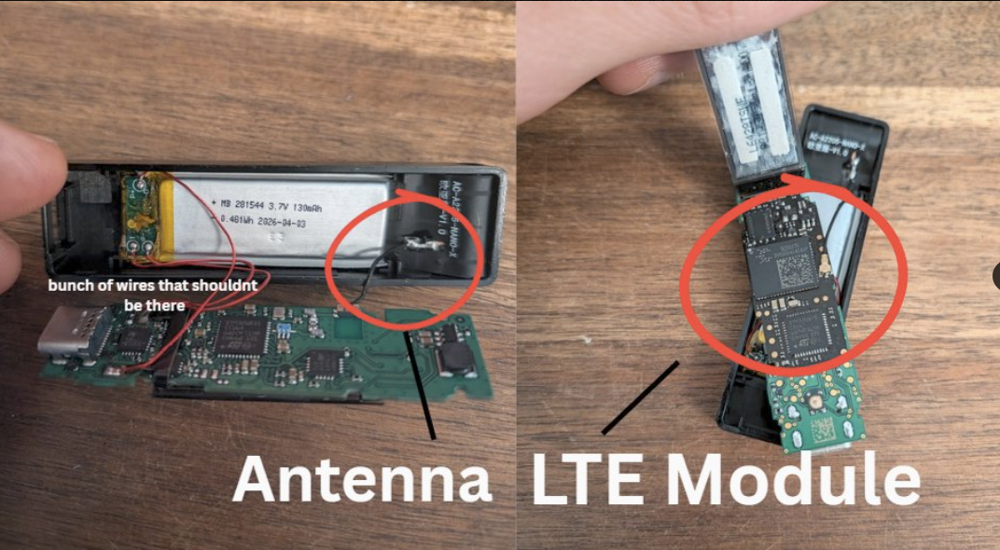

# Compromised Ledger Devices: How to Check Yours

In Asia and Europe, manipulated Ledger hardware devices have been found. It seems that about 100 million USD has been lost so far. Here is what's important:

If you **bought your device directly from Ledger, you are safe** (at least I have heard of no other cases). This is a supply chain attack. Some **authorized resellers seem to have sold manipulated devices** that contain additional cables and an LTE module. The LTE module lets the perpetrators send information from the Ledger to themselves. Which information? The seed phrase! The manipulated devices can read what the Ledger's screen shows. If the thieves record the screen while you set up the wallet, they can use your seed phrase to get access to your funds.

It is absolutely insane that this is possible. Ledger has disqualified itself many times over the years. Now it seems Ledger does not check thoroughly enough what its "authorized resellers" sell. After leaking users' personal data several times, this is a new low. In 2020, my home address leaked together with the information that I had bought a Ledger. Luckily I was planning to move anyway, but I still spent months afraid that someone might want to rob me. I never touched or recommended Ledger again.

Someone bought a Ledger at a MediaMarkt (in Germany, I assume) and found cables and an LTE module inside:

[Post on X: a Ledger bought at MediaMarkt with cables and an LTE module inside](https://x.com/0xJohannes_/status/2109634513957527974?s=20)

Here is a list of resellers to watch. It includes **MediaMarkt and Saturn, two of the biggest electronics stores in Austria and Germany**:

[Post on X: list of resellers to watch](https://x.com/Darkfost_Coc/status/2109715099220861117?s=20)

Ledger's acknowledgment:

[Ledger Support on X: acknowledgment](https://x.com/Ledger_Support/status/2108968264055345381?s=20)

Ledger's update on the compromised devices in Asia:

[Ledger on X: update on the compromised devices in Asia](https://x.com/Ledger/status/2109896739985453358?s=20)

## How to find out if your Ledger device was compromised

1. Check that you have a backup of your seed phrase.
2. If you added a passphrase, check that you have a backup of it too.
3. Check your funds. Is everything still there?

Here someone opens a Ledger to see if it has any cables inside:

[Post on X: opening a Ledger to look for cables](https://x.com/NewsAsset/status/2109228909443375126?s=20)

Now open your device. If you find cables or anything else that should not be there, act immediately:

1. Install BlueWallet on your phone.
2. Write down the seed phrase on a sheet of paper. Never store it digitally.
3. Add a long, random passphrase (the Bitwarden password manager can generate one for you).
4. Back up the new passphrase on paper. You can also save it in a password manager.
5. If you ever need to restore your wallet or move to another device, you will need the seed AND the passphrase. Be sure to back up both, but keep them separate from each other.
6. Send your funds from the Ledger to BlueWallet.
7. Buy a new hardware wallet: a BitBox or a Trezor. The Foundation Passport should also be good, although I have never used it myself.

Whenever you create a new wallet, always test that it works and that the backup is valid before you send funds to it. I wrote down my process [here](https://github.com/anitaonl/learn-bitcoin/blob/main/manuscript/500-security-measures.md#test-your-hardware-wallet).

As soon as you have the new hardware wallet, create a new seed and a new passphrase on it, then move the funds from BlueWallet to the new device.

If your device is not affected, I assume it is still safe to use. Personally, I would move away from Ledger in any case.

Ledger offers a website to check the integrity of the hardware:

[Ledger's integrity check for your device](https://support.ledger.com/article/4404382029329-zd)

But this account says the check does not find the real issue: the implant reads the seed phrase on the Ledger's screen.

[Post on X: how the implant reads the seed phrase](https://x.com/exsiway_/status/2109439465168982226?s=20)

> the implant is a tiny extra board hidden inside a real ledger. it doesn't hack the secure chip. it just reads the screen when you set up your wallet, your 24 words show up on the display. the implant reads them and sends them out over its own SIM card. the ledger keeps working normally that's why the genuine check doesn't catch it. the check only verifies the ledger chip, and the chip is real. the implant just taps the wire that carries pixels to the screen

Stay safe!
